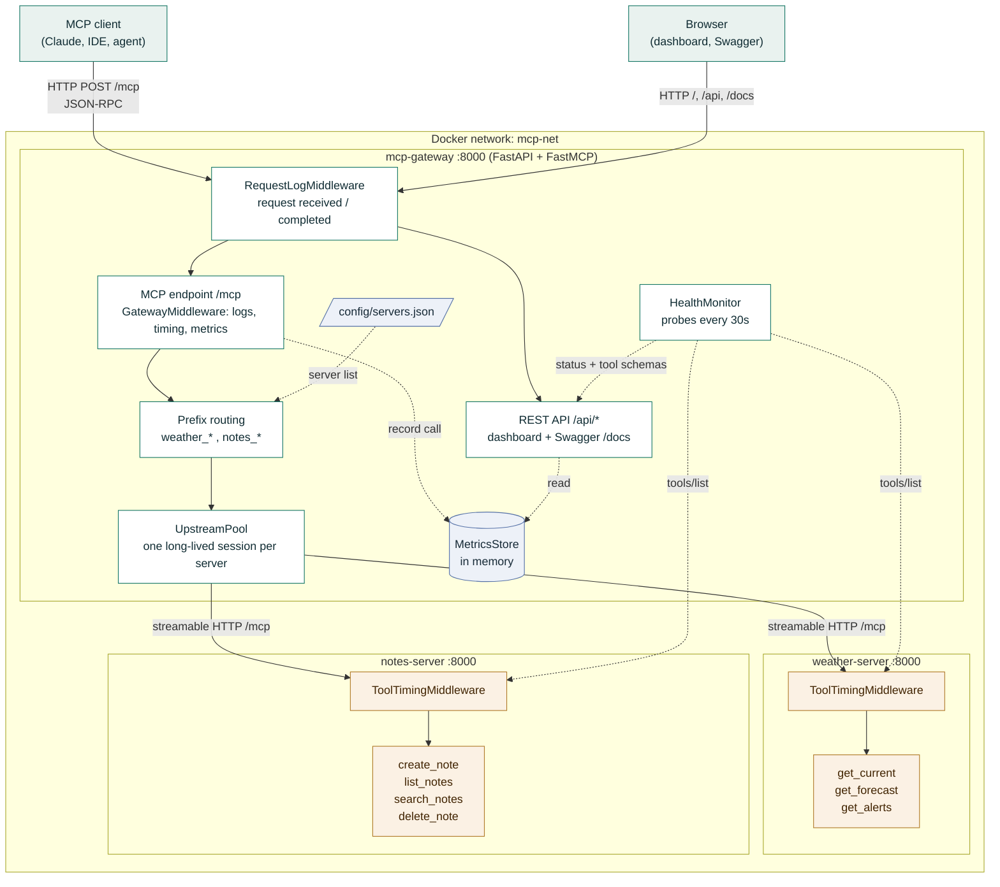
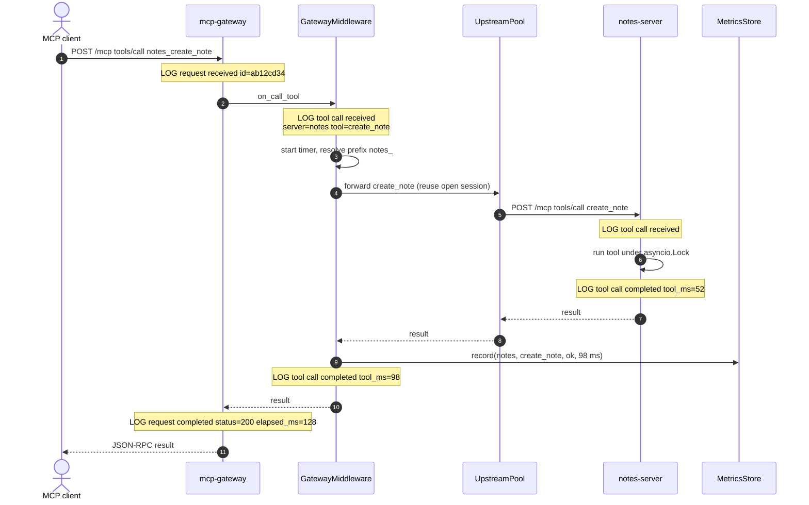
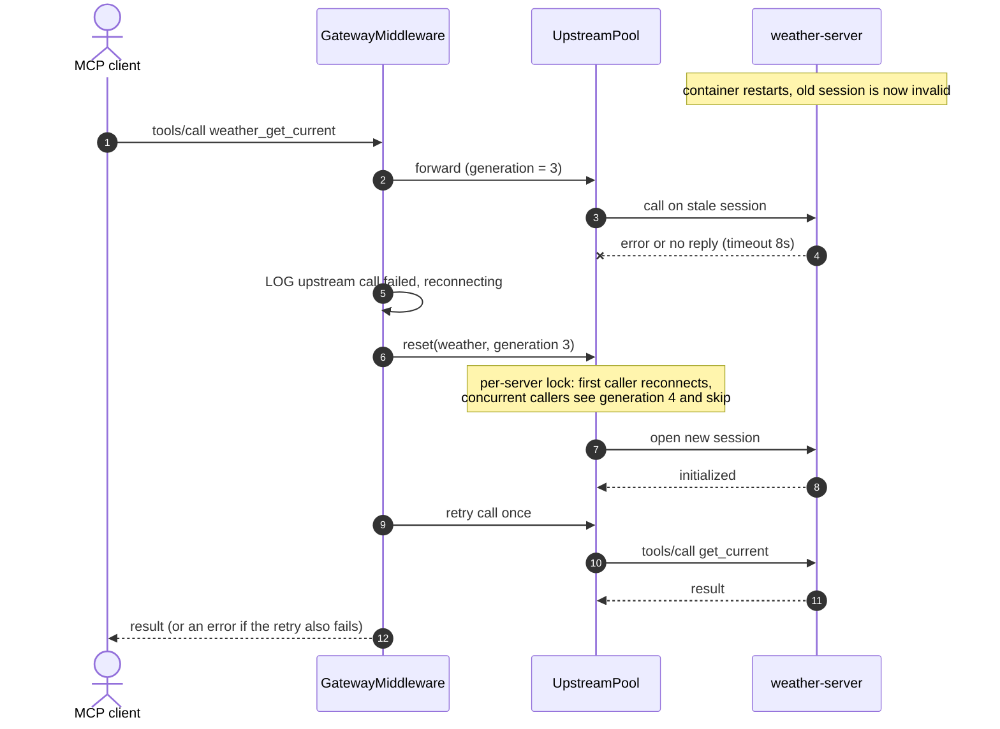
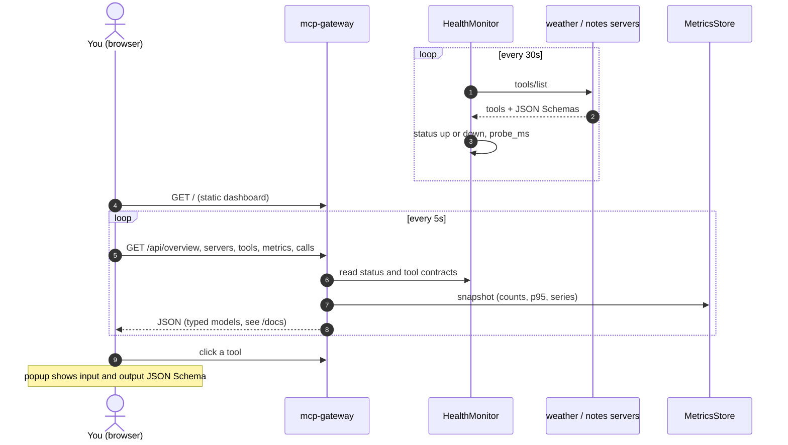

# Architecture

How the MCP gateway, the two MCP servers and the dashboard fit together. Diagrams are Mermaid
(rendered by GitHub, VS Code, and `architecture.html` in this folder).

## 1. System architecture

| Component | Responsibility |
|---|---|
| `RequestLogMiddleware` | Logs every HTTP request: received, completed, status, `elapsed_ms` |
| `GatewayMiddleware` | Logs each MCP message, times every tool call (`tool_ms`), records metrics, retries once on transport failure |
| Prefix routing | `weather_get_forecast` goes to `weather` as `get_forecast`; `notes_*` goes to `notes` |
| `UpstreamPool` | Keeps one open MCP session per server (cuts about 45 ms per call), single-flight reconnect |
| `HealthMonitor` | Probes servers, caches status and tool JSON Schemas for the dashboard |
| `MetricsStore` | Bounded in-memory call history: counts, success rate, avg, p95, per-minute series |

## 2. A tool call end to end

Gateway `tool_ms` minus server `tool_ms` is the gateway overhead (about 17 ms in local tests).

## 3. Upstream failure: timeout, reconnect, retry once

## 4. Dashboard and health probing

